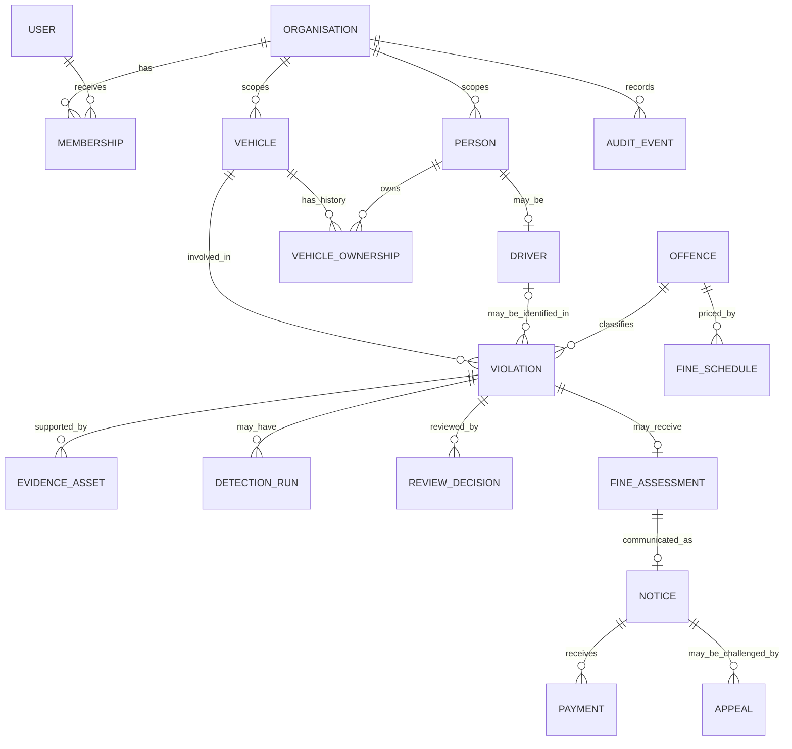
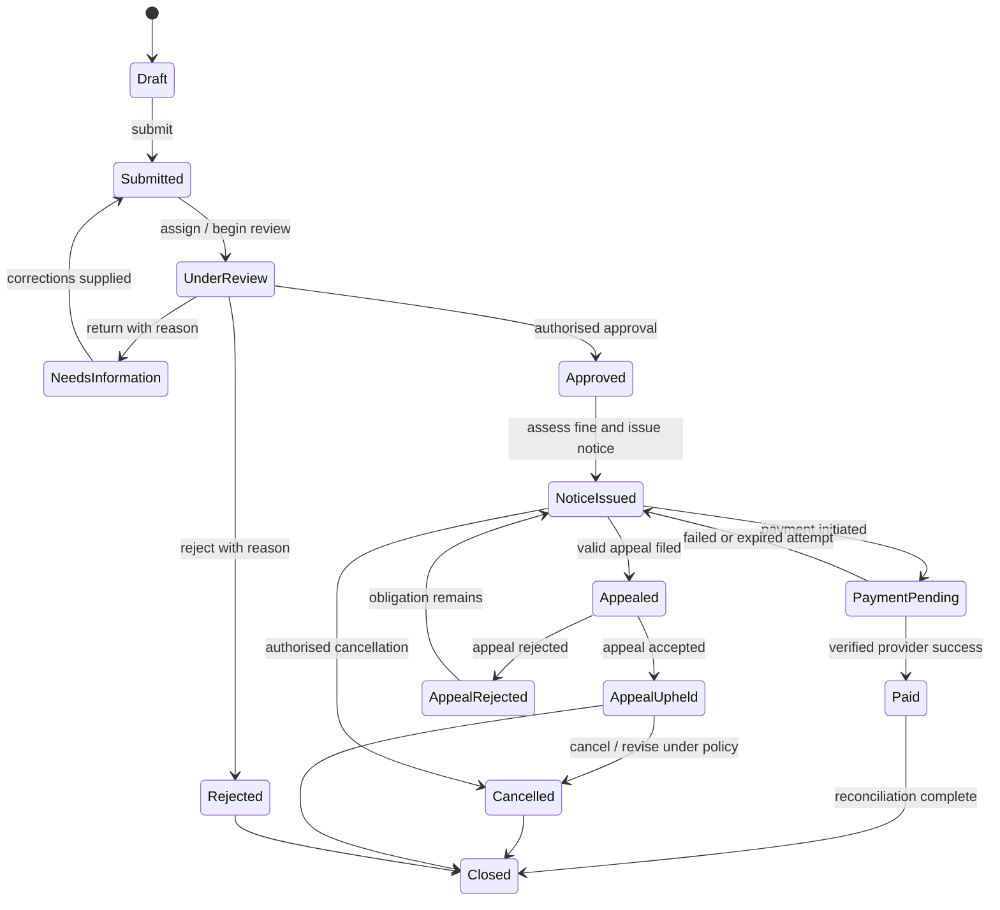

# 03 — Domain Model and Lifecycle

## 1. Core entities

| Entity | Meaning | Critical distinction |
|---|---|---|
| Organisation | Enforcement authority/tenant | Operational records are tenant-scoped. |
| User / Membership | Staff identity and role within an agency | Same user may have different roles per agency. |
| Person | An individual | Person is not synonymous with driver or owner. |
| Driver | Person with a licence record | May be unknown at case creation. |
| Vehicle | Registered vehicle | Registration plate is not a person identifier. |
| Vehicle ownership | Effective-dated relation between person and vehicle | Owner at event time may differ from current owner. |
| Jurisdiction | Area whose rules apply | Drives offence, schedule and procedural configuration. |
| Offence | Official offence definition | Description/code can change over time. |
| Fine schedule | Effective-dated amount/rule | Assessment snapshots exact version applied. |
| Violation | Case about an alleged traffic event | Not the same as an AI detection or payment. |
| Evidence asset | Original file or linked derivative | Original is immutable; derivative points to original. |
| Detection run | AI processing output | Candidate evidence, not a legal determination. |
| Review decision | Human approve/reject/return event | Actor and rationale are required. |
| Fine assessment | Deterministic calculated obligation | Stores schedule and calculation snapshot. |
| Notice/challan | Formal notice issued under policy | Public reference is non-sequential. |
| Payment | Provider transaction/attempt | May be pending, failed, reversed or refunded. |
| Appeal | Challenge to an issued notice | Does not erase original notice/decision. |
| Audit event | Immutable record of a material action | Separate from user-editable comments. |

## 2. Relationships

## 3. Violation lifecycle

This is a conceptual lifecycle. Production must define each transition's actor permission, required data, deadline behaviour, and legal exception. Payment and appeal states remain separately recorded; the violation status is a summary state, not the sole source of truth.

## 4. Domain invariants

1. Each violation belongs to exactly one organisation and jurisdiction.
2. Each violation references one vehicle and offence; driver is optional until verified.
3. Owner history is effective-dated; resolve the owner at event time when relevant.
4. Original evidence cannot be silently overwritten. Corrections/derivatives create new linked assets.
5. Every AI result records model/version and input evidence; it cannot itself approve a case.
6. Review decisions are immutable; a reversal is a new event.
7. Fine assessment stores schedule version, inputs, calculation and currency.
8. Issued notice stores unique reference, issue time, recipient-routing basis and obligation snapshot.
9. Payment events are idempotent; duplicate webhooks cannot double-credit.
10. Appeals preserve prior notices, assessments and decisions.
11. Cross-tenant access is denied by default at service and data-access layers.
12. Ordinary application roles cannot alter/delete audit records.

## 5. Fine schedule rules

Use integer minor units or fixed-precision decimals with explicit currency. Fine calculation must be deterministic and versioned. A schedule should contain jurisdiction, offence code, vehicle class/conditions, effective range, amount/currency, official source, version, approver, approval time and any permitted modifiers.

Select the schedule using the event date/time, not notice creation time, unless the governing rule explicitly specifies otherwise.

## 6. Duplicate handling

Do not treat plate number alone as a duplicate key. Candidate matching may consider organisation, source event ID, camera/device, event time window, normalised plate candidate, offence category and evidence hash. Ambiguous matches go to review; they must not silently discard a potentially distinct event.

## 7. Correction and retention

Use auditable amendments rather than destructive updates for important operational records. Define a retention matrix by record type, purpose, legal basis, retention trigger/duration, legal-hold behaviour, disposal method and owner. Legal hold suspends scheduled disposal until an authorised release is recorded.