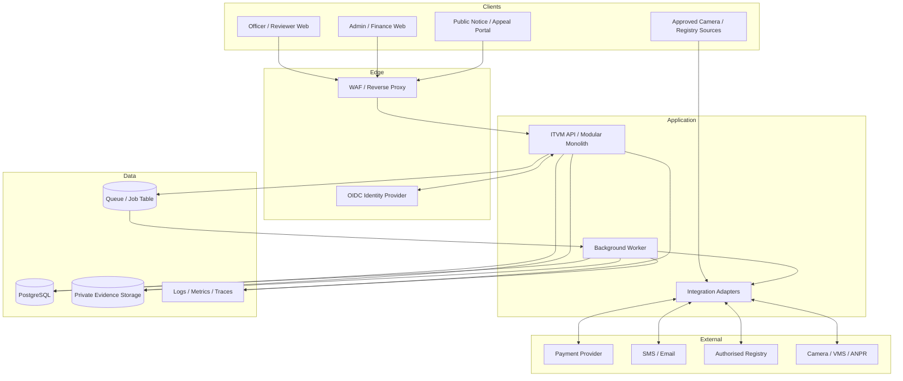

# 04 — Solution Architecture

## 1. Recommended approach

Start with a **modular monolith**: one application codebase with explicit domain modules and independently runnable background workers. This keeps early operations and transactions simple while leaving module boundaries clear enough for later extraction if scale or team ownership justifies it. Do not begin with microservices without a measurable reason.

## 2. Logical modules

| Module | Responsibility |
|---|---|
| Identity/tenancy | OIDC integration, agency scope, memberships, permission checks |
| Registry | Person, driver, vehicle and ownership history |
| Reference data | Jurisdictions, locations, offences and fine schedules |
| Case management | Violation creation, assignment, workflow and state transitions |
| Evidence | Upload, object storage, hash, access, retention, legal hold |
| Detection | AI candidate ingestion and model/inference metadata |
| Fine and notice | Deterministic calculation, rendering, issue/cancel/reissue |
| Payments | Provider adapter, intents, webhook inbox and reconciliation |
| Appeals | Filing, assignment, decision and deadline handling |
| Communications | Templates, delivery jobs and retries |
| Reporting | Read models, dashboards and controlled exports |
| Audit | Append-only business and security events |

## 3. Processing patterns

- Synchronous API: CRUD, case transitions, review decisions, fine assessment, notice issuance and appeal filing.
- Asynchronous jobs: malware scanning/transcoding, OCR/ANPR, bulk import, notice rendering, notifications, payment reconciliation and reports.
- Evidence: private object storage with short-lived upload/download URLs. Finalise only after server-side size/type checks, scanning where applicable and hash calculation.
- Transactional outbox: write business change and outbox record in the same DB transaction before asynchronous work.
- Webhook inbox: persist provider event, verify signature, deduplicate by provider event ID, then process idempotently.

## 4. Data ownership and boundaries

- PostgreSQL is the source of truth for transactional records.
- Object storage holds binary evidence; database stores its metadata, hash, object key and lifecycle status.
- External systems remain authoritative for their registry/payment facts; ITVM stores only authorised references and snapshots required for workflow/audit.
- Analytics/read models are derived and rebuildable, not alternate write authorities.
- Repository/service queries always apply organisation scope. Consider database row-level security as defence in depth.

## 5. Technology guidance

| Concern | Baseline | Notes |
|---|---|---|
| Database | PostgreSQL | Transactions and relational constraints; JSONB only for bounded metadata. |
| API | REST + OpenAPI 3.1 | Stable integration contract. |
| UI | Responsive SPA or server-rendered app | Choose based on team and hosting environment. |
| Background work | Durable queue or DB-backed job runner | Retry, dead-letter and idempotency support. |
| Evidence | Private S3-compatible/object storage | Encryption, versioning, access logs and policy-based retention. |
| Identity | OIDC provider | MFA, lifecycle and session revocation. |
| Observability | OpenTelemetry-compatible | Correlation across API, worker and integrations. |
| Runtime | Containers on approved infrastructure | Cloud or on-premises subject to authority policy. |

These are reference choices, not vendor commitments.

## 6. Failure handling

- Payment outage: keep case history available; pause payment initiation and surface provider health.
- Evidence storage outage: do not finalise mandatory evidence or approve an incomplete case.
- Notification outage: retain retryable jobs; delivery failure does not erase an issued notice.
- Registry outage: mark data stale/unverified; do not overwrite known-good values with errors.
- Queue failure: preserve jobs and alert operators.
- External calls: enforce timeouts, bounded retries with jitter and operator-visible exception states.

## 7. Security architecture

Use TLS, private database/queue/object-storage networking, OIDC, MFA for privileged roles, short-lived credentials, secret manager, service-level tenant checks, database defence in depth and audit of high-risk operations. Separate production/non-production accounts, keys and data.

## 8. Architecture priorities

Prioritise correctness, evidence integrity, auditability, privacy and operability over speculative throughput optimisation. Build a pilot workload model before adopting specialised infrastructure or extracting services.