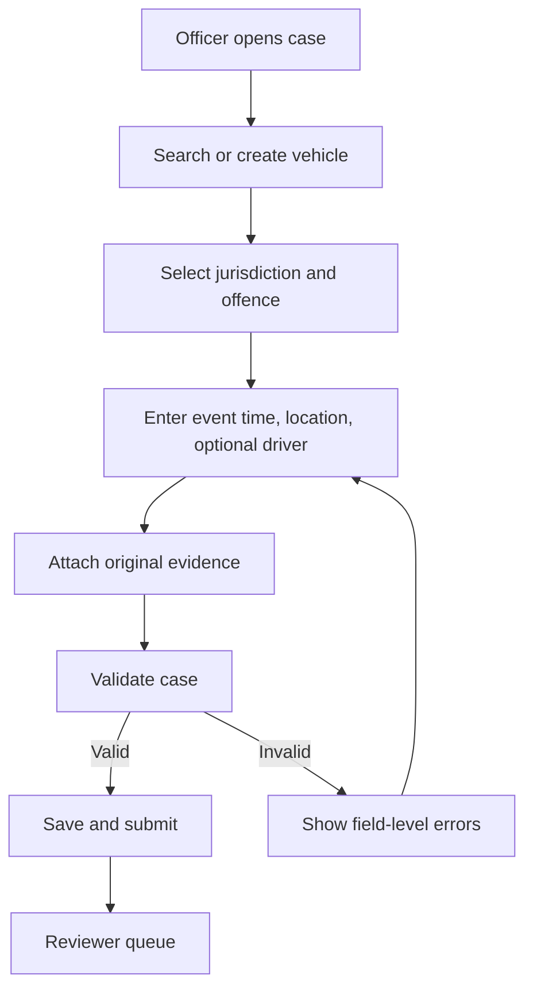

# 08 — UX and Workflow Specification

## Experience principles
- Optimise officer workflows for rapid, low-error capture; keep legal context visible.
- Show current state, next action, assignee, due date and exceptions prominently.
- Separate AI suggestions from verified facts; show provenance for registry values and evidence.
- Distinguish assessed, issued, paid, outstanding, refunded and settled amounts.
- Make irreversible actions explicit and reasoned.
- Support keyboard use, screen readers, responsive layouts, visible focus and accessible errors.

## Staff screens
1. **Sign-in/access denied:** OIDC; do not reveal protected record existence.
2. **Dashboard:** unassigned cases, review backlog, ageing, payment exceptions, appeal deadlines, system alerts.
3. **Violation queue:** filters for status, offence, date, location, reviewer, source and evidence quality.
4. **Create violation:** find vehicle; optionally select driver; choose offence; enter event/time zone, location, source; attach evidence; validate/save draft.
5. **Violation detail:** facts, vehicle/driver, owner-at-event, evidence viewer, optional AI panel, status history and allowed actions.
6. **Review workbench:** original evidence beside structured facts; approve/reject/return with mandatory rationale.
7. **Fine assessment:** schedule version, applicability, calculation, amount, currency, due date and authorised adjustment controls.
8. **Notice preview:** recipient, public reference, offence, evidence disclosure, amount, payment and appeal instructions.
9. **Payments/reconciliation:** attempts, provider references, webhook history, settlement status, refund/reversal exceptions.
10. **Appeals queue:** reason, documents, deadlines, case history, assignee and decision editor.
11. **Registry administration:** vehicles, drivers, ownership history, source and verification status.
12. **Configuration:** jurisdiction, offence schedule, locations, templates, providers, roles and retention.
13. **Audit explorer:** actor/action/entity/time/correlation filters; export restricted.

## Public portal
- Notice lookup with high-entropy reference and approved recipient verification.
- Limited notice summary and permitted evidence disclosure.
- Payment initiation and receipt/status.
- Appeal submission and acknowledgement.
- Contact/support instructions and language/accessibility options.

## Main workflows

### Manual violation entry

### Review and decision
1. Reviewer opens assigned case.
2. System enforces role and maker-checker rule.
3. Reviewer checks evidence, provenance, timestamps, vehicle, offence applicability and AI suggestion (if any).
4. Reviewer selects approve, reject or needs-information and enters rationale.
5. System writes decision and changes case state transactionally.
6. Approved case becomes eligible for fine assessment; notice is not issued automatically.

### Fine assessment and notice
1. Authorised role selects an effective schedule.
2. Server validates jurisdiction/offence/class/event date and calculates fine.
3. Assessment stores a complete schedule/calculation snapshot.
4. User previews notice.
5. Authorised user issues it; system creates public reference and issuance audit event.
6. Delivery job is queued; failed delivery remains visible without erasing the issued notice.

### Payment
1. Recipient verifies access to notice and starts payment.
2. ITVM creates an idempotent payment attempt.
3. Provider handles payment credentials and checkout.
4. ITVM receives signed provider callback; duplicate callbacks are harmless.
5. Payment state is updated and reconciled; receipt is generated.
6. Balance is recomputed from successful non-reversed payments and authorised adjustments.

### Appeal
1. Recipient verifies access and submits reason/material.
2. System checks configured eligibility window.
3. Appeal is acknowledged and assigned.
4. Reviewer inspects original evidence, notice snapshot, case history and appeal material.
5. Decision and rationale are recorded; any financial/notice change is a separate authorised action.
6. Recipient receives outcome notification.

## Form behaviour and accessibility
- Use explicit labels; placeholder is not a label.
- Display time zone and preserve source capture timestamp.
- Do not require a driver if not known or required at that stage.
- Mark plate OCR as “AI suggestion — not verified” until human confirmation.
- Fine calculation is server-side; client calculation is display-only.
- Warn about unsaved changes; show upload progress, retry and final hash status.
- Never display full licence number or unnecessary contact details publicly.
- Target WCAG 2.2 AA: test keyboard navigation, focus, contrast, semantic structure, screen-reader announcements, zoom/reflow and error summaries.
- Store UTC instants; render using jurisdiction timezone/locale. Currency and decimal formats must be explicit.