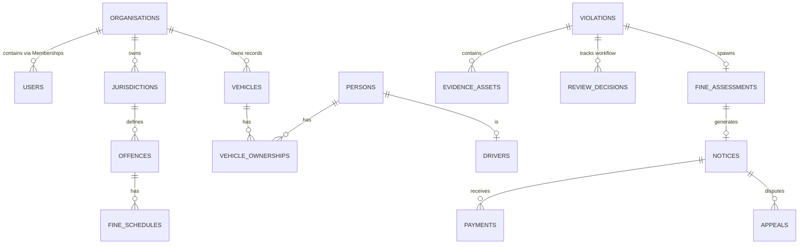

# DATABASE DESIGN (CO1)

## Overview
This document covers the Intelligent Traffic Violation Management (ITVM) relational database implementation, focusing on entity normalization, constraints, and relationships that facilitate scalable organization-scoped compliance tracking.

## Core Entities
1. **Organisation:** The highest-level tenant wrapper (e.g., Traffic Police Department).
2. **User & Membership:** Implements RBAC and multitenancy. Users can belong to multiple organizations by utilizing `Membership`.
3. **Jurisdiction:** Defined operating regions/zones under an organization.
4. **Driver & Vehicle:** Linked through an intersection table `vehicle_ownerships`. Note `Driver` contains highly sensitive data, securely storing the `licence_number_ciphertext` using AES (via `cryptography`).
5. **Offence & FineSchedule:** A master catalogue mapping an `Offence` to a temporal `FineSchedule`, ensuring historical fines remain accurate over time without breaking previous transactions if laws change.
6. **Violation, Evidence, ReviewDecision:** Operational workflows. Violations trigger Review Decisions. Valid implementations enforce evidence requirement rules prior to approval processing.
7. **FineAssessment, Notice, Payment:** Financial components orchestrating collection flows.

## Mermaid ER Diagram

## Security and Integrity
- **Unique Constraints:** `vehicle.registration_normalised` enforces single active registry representation within jurisdictions. `users.email` is universally unique across tenants.
- **Tenant Scoping:** All critical entities directly back-reference `organisation_id` ensuring simple, safe application-level tenant isolation logic during SELECT clauses.
