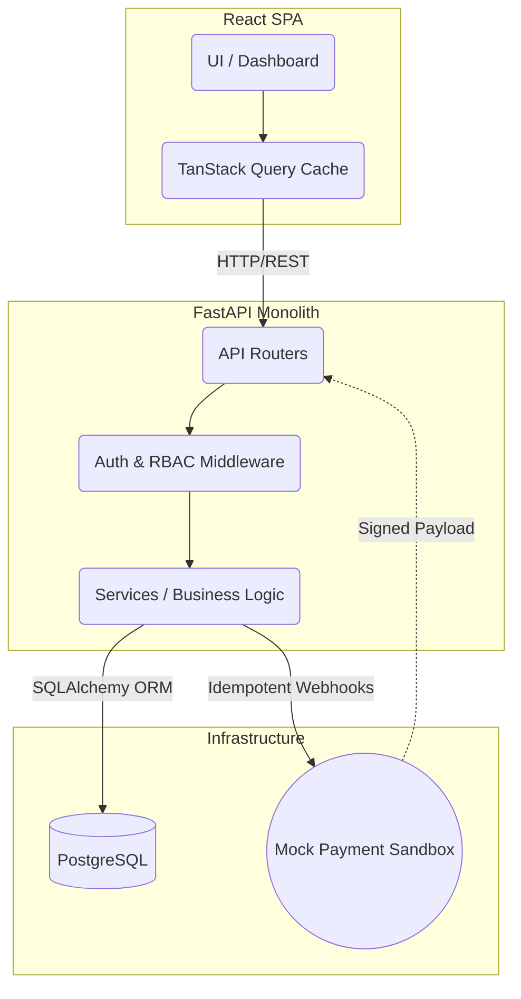

# SYSTEM ARCHITECTURE (CO4)

The ITVM application leverages a highly disciplined **Modular Monolith** architecture avoiding unnecessary microservice overhead for robust domain transactionality.

## Component Flow Overview

## Data Integration & Flow
1. **Frontend-to-Backend:** Standardized HTTP/REST APIs, passing `Authorization` JWT and `X-Organisation-ID` for explicit multi-tenant scoping.
2. **Review to Finance Pipeline:** A violation moves to `approved` state in `ReviewDecision`, which unlocks the `/assess` API resolving the exact matching `FineSchedule` snapshot and generating an immutable `FineAssessment`.
3. **Idempotent Callbacks:** Mock webhook callbacks (`/webhook/sandbox`) validate signature headers, parse payloads, and commit idempotent transitions tracking to `PaymentLedgerEntry` preventing double-counting.
